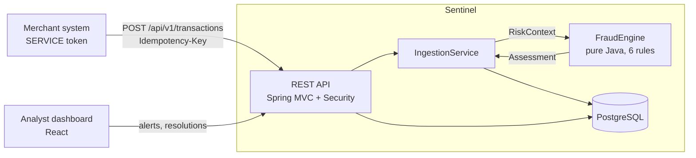

# Architecture

Sentinel scores payment transactions as they arrive and gives fraud analysts a queue of the risky ones to review.

## One transaction, step by step

1. The caller sends `POST /api/v1/transactions` with a service token and an `Idempotency-Key`.
2. Bean Validation checks the body: positive amount, at most 2 decimals, ISO currency and country codes.
3. `IngestionService` looks the key up. A repeat of the same request returns the stored result. The same key with a different body is a `409`.
4. It loads the account's recent history, known devices and blacklist matches (a handful of indexed queries).
5. It hands that data to `FraudEngine` as a `RiskContext`. Each rule returns a score and a human-readable reason, or nothing. Scores add up, capped at 100.
6. The total maps to a decision: below 40 approve, 40 to 79 review, 80 and above decline.
7. The transaction, every rule hit, and (for review or decline) an alert are saved in one database transaction.
8. The response includes the decision, the score and the reasons.

## Layers

| Package | Responsibility | Depends on |
|---|---|---|
| `engine` | Rules, scoring, decisions. Plain Java, no Spring, no database | nothing |
| `persistence` | JPA entities and repositories | `engine` (enums) |
| `service` | Use cases: ingest, alerts, blacklist, login, audit | `engine`, `persistence` |
| `api` | HTTP controllers, request and response shapes, error mapping | `service` |
| `config` | Properties, security, wiring of the engine | everything above |

The engine knowing nothing about Spring or SQL is the main design choice. It is why the rules are fast to test (see `engine/*Test`) and why a rule can be understood without reading any framework code.

## Data model

- `fraud_transaction`: one row per assessed transaction. No card number is stored anywhere.
- `rule_hit`: which rules fired, with score and reason. This is what makes every decision explainable.
- `alert`: the analyst work queue, with an optimistic-lock version so two analysts cannot both resolve the same alert.
- `blacklist_entry`, `app_user`, `audit_log`: operations and accountability. The audit log is append-only.

The schema is owned by Flyway migrations (`src/main/resources/db/migration`). Hibernate only validates it at startup.

## Security model

| Role | Can do |
|---|---|
| `SERVICE` | Send transactions |
| `ANALYST` | Read transactions and alerts, resolve alerts |
| `ADMIN` | Everything, plus blacklist management and metrics |

Tokens are signed JWTs (HS256) that expire after 15 minutes. See ADR-006.

## Operations

- Health: `/actuator/health` (liveness and readiness probes are enabled).
- Metrics: `/actuator/prometheus` (admin only), including `sentinel_decisions_total` by decision.
- Every request has an `X-Request-Id`, and the same id appears in every log line for that request.

## Not built yet

Kafka for asynchronous processing, Redis for hot counters, webhooks with the outbox pattern, load tests, and a Grafana dashboard. The current design keeps the database as the single source of truth, which is the right starting point; see the roadmap in the README.
